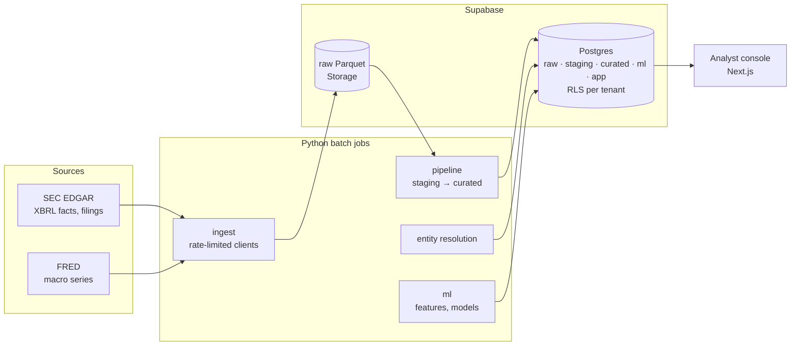

<div align="center">

# Covenant

### Credit Early Warning Platform

**Credit early-warning platform for lenders: messy SEC filings in, explainable 12-month distress alerts out.**

[](https://apatha32.github.io/Covenant---Credit-early-warning-platform/)
[](#roadmap)
[](https://github.com/apatha32/Covenant---Credit-early-warning-platform)
[](https://github.com/apatha32/Covenant---Credit-early-warning-platform/actions/workflows/ci.yml)

</div>

## What it does

A credit team at a private-credit fund or mid-market lender uploads its borrower list, often a messy spreadsheet of names
and maybe tickers. Covenant:

1. **Resolves each borrower to its SEC entity.** Uncertain matches go to a human review queue
   instead of being guessed.
2. **Rebuilds each company's financials point in time** from raw XBRL filings: every number as it
   was known on any past date, with the exact filing and tag it came from.
3. **Scores 12-month distress risk** with a calibrated LightGBM model and explains, in plain
   English, why a borrower is flagged.
4. **Gives analysts a console** for the watchlist, drill-downs with evidence, "ask the filings"
   Q&A with citations, and alert dispositions (Phase 5–6).

## Results so far

| Area | Result | Evidence |
|---|---|---|
| Ingestion | 4.0M XBRL facts, 337k filings and 5 FRED macro series for a 205-company dev sample; re-runs are idempotent (0 new rows on a second run); SEC rate limit held at ≤ 8 requests/sec | `raw.ingest_runs` counts |
| Bankruptcy event scan | 25/25 known Chapter 11 filers found in their petition year; 6 suspicious tags read and documented (mis-tags, co-registrants, subsidiary-only filings) | [spot-check](reports/item_103_spotcheck.md), [review](reports/item_103_review.md) |
| Canonical financials | 25 metrics from 50+ XBRL tags with ordered fallback, year-to-date → quarterly derivation, restatement versions, scale-error quarantine; core metrics complete for 139/179 active companies | [coverage report](reports/metric_coverage.md) |
| Entity resolution | **100% auto-match precision at 82% coverage** on a held-out 100-row messy file (typos, old names, missing/wrong tickers); **0 wrong matches** on hand-written subsidiary/namesake traps | [evaluation](reports/entity_resolution_eval.md) |
| Distress model | **LightGBM PR-AUC 0.098 vs 0.019 for an Altman Z'' baseline** (5x; base rate 1.1%) on 2022+ test data across ~6,000 companies; 65% of bankruptcies ranked in the riskiest 10%; flagged a median **14 months** before filing (151 of 211); beats Altman in every backtest year 2015-2024 | [model card](reports/model_eval.md) |
| Engineering | Leakage test (features recomputed with all later data deleted must not change, and a planted leak must be caught), Postgres row-level security for multi-tenancy, 249 automated tests in CI against a real Supabase database | [CI](https://github.com/apatha32/Covenant---Credit-early-warning-platform/actions) |

## Architecture



## Roadmap

| Phase | Scope | Status |
|---|---|---|
| 0 | Monorepo, config, migrations, row-level security, CI | ✅ Done |
| 1 | SEC + FRED ingestion, dev sample, bankruptcy event scan | ✅ Done |
| 2 | Cleaning & canonical point-in-time financial model | ✅ Done |
| 3 | Entity resolution: upload, matching, review queue | ✅ Done |
| 4 | Features, labels, Altman / logistic / LightGBM models, SHAP, model card | ✅ Done |
| 5 | LLM risk signals from filing text, Q&A with citations | Next |
| 6a | Analyst console + read-only public demo ([PR #11](https://github.com/apatha32/Covenant---Credit-early-warning-platform/pull/11)) | Built, going live |
| 6b | API, borrower upload and review, alerts | Planned |
| 7 | Hosting (Supabase + scheduled jobs + Vercel), drift monitoring, alerts | Planned |

**Stack:** Python 3.12, Polars, PostgreSQL / Supabase (RLS, Storage, pgvector), rapidfuzz,
Pandera, scikit-learn, LightGBM with TreeSHAP, Claude API (Phase 5), Next.js (Phase 6).
Full build spec: [SPEC.md](SPEC.md).

## Repository layout

```
packages/common/     tripwire_common: settings (env), YAML config loaders, JSON logging, DB helpers
services/ingest/     SEC + FRED clients, rate limiter, raw Parquet landing, dev sample, Item 1.03 scan
services/pipeline/   raw -> staging -> curated (tag mapping, YTD derivation, versions, events);
                     entity/ = borrower upload, matching cascade, review queue
services/ml/         labels (text-checked), point-in-time features, models, evaluation, model card
services/            llm, api: one uv workspace member each (empty until their phase)
supabase/migrations/ schema + RLS, applied by the Supabase CLI
supabase/local/      supabase_shim.sql: Supabase roles + auth.uid() for plain-Postgres dev/tests
config/              models.yaml (LLM/ML settings) and domain/finance/ (the finance domain pack)
tests/               common/, db/ (RLS, schema guards), ingest/, pipeline/, entity/
reports/             committed data reports (bankruptcy scan, coverage, entity resolution)
apps/web/            Next.js console (Phase 6)
```

## Quickstart

Requires [uv](https://docs.astral.sh/uv/) and Docker.

```sh
cp .env.example .env      # fill in keys as phases need them
make setup                # uv sync --all-packages (installs Python 3.12 env)
make db-up                # Postgres 17 + pgvector on localhost:54329
make check                # ruff, mypy --strict, pytest
make db-reset             # optional: wipe the local DB and apply shim + migrations to it
```

DB tests create and drop their own throwaway database on `TEST_DATABASE_URL`, so they never
touch your working data. Without a reachable server they skip; with `REQUIRE_DB=1` (CI) they fail.

## Ingestion (Phase 1)

Needs `SEC_USER_AGENT` (name + email) and `FRED_API_KEY` in `.env`, and the local DB (`make db-reset`).

```sh
uv run python -m tripwire_ingest dev        # tickers, sample, submissions, companyfacts, fred, scan
uv run python -m tripwire_ingest --help     # individual commands
```

- **Raw landing:** Parquet goes to `data/` (local storage backend) under content-addressed keys
  (`.../sha256=<payload hash>/...`), indexed in `raw.*_index` / `raw.source_files`. Re-running
  writes nothing new for unchanged data (counted as `unchanged` in `raw.ingest_runs.counts`).
- **Rate limit:** SEC requests are capped at 8/sec (token bucket, retries included). Every run
  records `max_requests_per_second` actually observed.
- **Dev sample:** `config/domain/finance/dev_sample.yaml` is generated once and committed, so
  every re-run ingests the same 205 companies.
- **Item 1.03 scan:** `reports/item_103_spotcheck.md` (generated) plus
  `reports/item_103_review.md` (manual review). Issues are logged to `staging.quarantine`.

## Pipeline (Phase 2)

```sh
uv run python -m tripwire_pipeline all      # staging, curated, events, coverage report
```

- **Staging:** mapped XBRL facts typed into `staging.facts`; rule violations (non-USD unit, bad
  dates, conflicting duplicates, ...) go to `staging.quarantine`. Output checked by a Pandera contract.
- **Curated:** `curated.financial_metric`, 25 canonical metrics from `metric_mapping.yaml`, with
  the chosen tag, every version, and YTD-derived quarters (lineage in `derivation`).
- **Point in time:** `select * from curated.financial_metric_as_of('2024-02-20', '1')` returns
  each metric as known on that date. Features must read through it.
- **Events:** `curated.filing_event` from 8-K items and NT 10-K / NT 10-Q.
- **Coverage:** `reports/metric_coverage.md`.

## Entity resolution (Phase 3)

`tripwire_pipeline.entity` turns an uploaded borrower CSV into SEC companies:

- **Columns:** found by header (`name` / `company` / `borrower_name` …, `ticker` / `symbol` …).
  Extra columns are ignored.
- **Cascade:** a prior human decision, then exact ticker (cross-checked against the name), then
  exact current/former name, then fuzzy name. Confidence below 0.90 means the row goes to
  `app.match_review` with up to 5 candidates. Settings are in `config/entity_resolution.yaml`.
- **Decisions:** stored per tenant in `app.entity_alias` (RLS), reused on later uploads and
  applied to every pending row with the same input. They are never shared across tenants.
- **Accuracy:** `reports/entity_resolution_eval.md` (`scripts/eval_entity_resolution.py`). On the
  100-row hold-out file, 100% auto-match precision with 82% auto-matched. On hand-written
  adversarial cases (subsidiaries, namesakes), 0 wrong auto-matches.

## Models (Phase 4)

```sh
uv run python -m tripwire_ingest bulk            # SEC bulk zips (~3 GB) into raw storage
uv run python -m tripwire_pipeline training-data # 11k companies -> Parquet (same Phase 2 code)
uv run python -m tripwire_ml labels              # classify 2.7k Item 1.03 8-Ks from their text
uv run python -m tripwire_ml dataset             # quarterly point-in-time features + labels
uv run python -m tripwire_ml train               # 3 models, backtest, registry, model card
```

- **Labels:** the 8-K Item 1.03 tag is noisy, so each filing's text is classified (own petition,
  subsidiary-only, sister company, follow-up, mis-tag) with rules in
  `config/domain/finance/labels.yaml`. Estimated precision ≈ 88% from a fresh hand-checked
  sample. Rows inside a bankruptcy are excluded.
- **Features:** 56 point-in-time features (Altman Z'' components, leverage, coverage, liquidity,
  runway, trends, filing behavior, macro as released, missingness). One function computes them,
  for training and scoring alike.
- **Leakage test:** features recomputed after deleting every later filing, restatement and macro
  release must be identical; it runs in CI (with a planted leak that must be caught) and on real
  data during every dataset build.
- **Models:** Altman Z'' rule, logistic regression, LightGBM; isotonic calibration on validation;
  time-based splits with non-overlapping label windows; rolling-origin backtest; TreeSHAP drivers
  in plain English; registry in `ml.model_version` with a promotion rule.

Against a real Supabase stack instead of the shim: `supabase db start` (database only) or
`supabase start` (full local stack), then `supabase db push` to deploy to a linked project.

## Database design

| Schema | Holds | Who can read |
|---|---|---|
| `raw` | ingest run log, index of raw Parquet files in Storage | service_role |
| `staging` | typed facts and filings, quarantine, LLM call cache | service_role |
| `curated` | canonical point-in-time model: companies, metrics, events, text signals, chunks, macro | service_role |
| `ml` | feature snapshots, labels, model registry, predictions, drift | service_role |
| `app` | tenants, portfolios, matches, alerts, dispositions, audit log | authenticated, own tenant only |

Key decisions:

- **Tenant isolation in two layers.** RLS on every `app` table scopes rows to the caller's
  memberships (`app.user_tenant_ids()`, `app.has_role()`). Children carry `tenant_id` and
  reference parents by the composite `(id, tenant_id)`, so a row cannot point at another
  tenant's parent even though FK checks bypass RLS. Column-level UPDATE grants stop users from
  moving rows across tenants or editing fields like an alert's reason.
- **Roles:** owner > admin > analyst > viewer. Viewers read only; only owners can grant owner.
- **Pipeline schemas are service-only.** RLS is still enabled on every table (deny by default)
  so an accidental grant exposes nothing. The tests fail if any table lacks RLS.
- **History is append-only.** `curated.financial_metric`, `ml.prediction`, `app.disposition`,
  `app.audit_log` and the raw indexes reject UPDATE/DELETE with a trigger. Restatements are new
  `version`s; derived values (e.g. Q4 = FY − 9M) must carry `derivation` lineage.
- **Point-in-time.** Every row a feature can read carries `filed_date`. `ml.feature_snapshot`
  has a check that its `max_source_filed_date <= as_of_date`, a last-line leakage guard behind
  the Phase 4 leakage test. Macro data is bitemporal (`observation_date`, `release_date`).
- **SEC identifiers are validated types:** `util.cik` (10-digit zero-padded) and
  `util.accession` (`0000320193-23-000106`). Filings are keyed by `(cik, accession)` because one
  accession can list several co-registrants (relevant to the 8-K 1.03 subsidiary issue).
- **Config, not code:** LLM model names live in `config/models.yaml` (a test fails if a model
  ID appears in Python); event codes, SIC exclusions and label rules live in
  `config/domain/finance/`.

## Open questions

1. **Embeddings provider.** Claude has no embeddings endpoint. `models.yaml` assumes Voyage
   (`voyage-3.5`, 1024 dims, matching `curated.filing_chunk.embedding`). Confirm before Phase 5.
2. **Bankruptcy label recall.** Labels are now text-checked (≈ 88% precision), but companies that
   go bankrupt without filing an Item 1.03 8-K are not seen, and recall is not measured.
3. **WeWork vs sector exclusion.** WeWork is SIC 6512 (real estate), so the spec's exclusion
   rule removes a bankruptcy the spec names as a dev-sample example.
4. **Credit spread.** FRED now serves only 3 years of `BAMLH0A0HYM2`; `BAA10Y` replaces it
   (SPEC.md 3.9).
5. **Entity-resolution universe.** Only current SEC registrants plus known former names. The bulk
   submissions (Phase 4) now hold all 43k operating filers with former names; wiring them into
   matching is pending.
6. **Tenant offboarding.** Alerts, dispositions and audit rows are history and do not cascade,
   so deleting a tenant needs an explicit admin procedure.
7. **Calibration drift.** Probabilities are calibrated on 2020 (a low-default year) and run about
   25% low on 2022+ data; recalibration belongs with drift monitoring (Phase 7).
